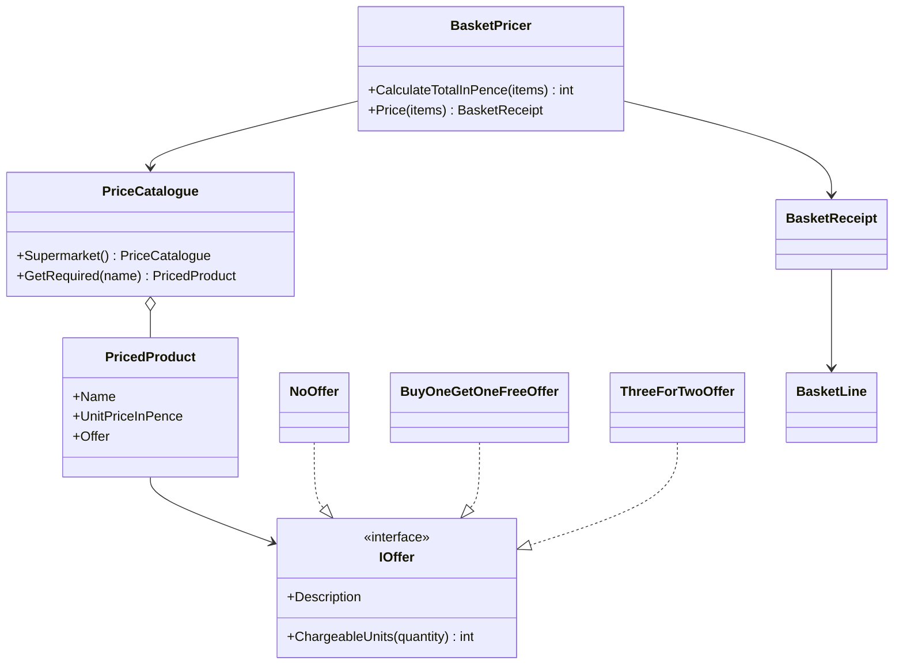
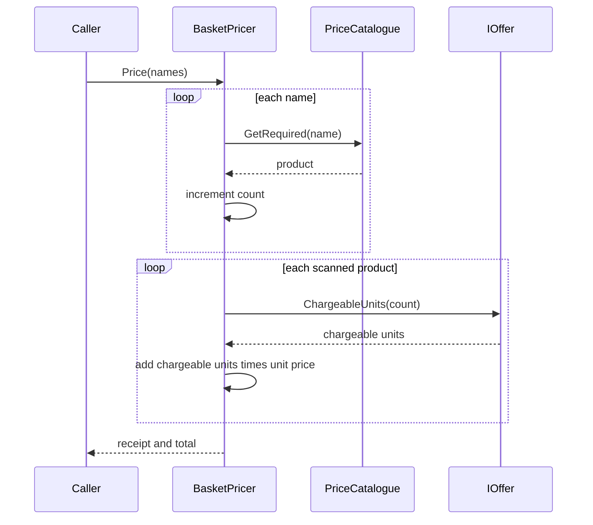

# Shopping basket design

## Problem

Given a list of item names, calculate the total cost of the basket.

The same name may appear more than once. Each appearance is one unit. `["Apple", "Apple", "Banana"]` is two apples and one banana.

| Product | Unit price | Offer |
| --- | --- | --- |
| Apple | 35p | None |
| Banana | 20p | None |
| Melon | 50p | Buy one, get one free |
| Lime | 15p | Three for the price of two |

## Result

`BasketPricer.CalculateTotalInPence` returns the total as a whole number of pence.

`BasketPricer.Price` returns a receipt: one line per distinct product, in catalogue order, plus the same total. The console program prints that receipt in pounds and pence.

## Rules

Offers apply to the **total quantity of one product** in the basket. They do not depend on the order of the list, and they do not combine across different products.

### Full price

Chargeable units = quantity.

Cost = quantity × unit price.

### Buy one, get one free (melons)

Items are paired. One item in each pair is free. A single leftover item is charged.

Chargeable units = ceil(quantity / 2) = (quantity + 1) / 2, using integer division.

| Melons scanned | Charged | Cost |
| --- | --- | --- |
| 1 | 1 | 50p |
| 2 | 1 | 50p |
| 3 | 2 | 100p |
| 4 | 2 | 100p |
| 5 | 3 | 150p |

### Three for the price of two (limes)

Each complete group of three is charged as two. One or two leftover limes are charged at full price.

Chargeable units = (quantity / 3) × 2 + (quantity % 3).

| Limes scanned | Charged | Cost |
| --- | --- | --- |
| 1 | 1 | 15p |
| 2 | 2 | 30p |
| 3 | 2 | 30p |
| 4 | 3 | 45p |
| 5 | 4 | 60p |
| 6 | 4 | 60p |
| 7 | 5 | 75p |

### Worked baskets

| Basket | Calculation | Total |
| --- | --- | --- |
| Apple, Apple, Banana | 35 + 35 + 20 | 90p (£0.90) |
| Melon, Melon, Lime, Lime, Lime, Apple | 50 + 30 + 35 | 115p (£1.15) |
| Apple, Apple, Banana, Melon, Melon, Lime, Lime, Lime | 70 + 20 + 50 + 30 | 170p (£1.70) |
| One of each | 35 + 20 + 50 + 15 | 120p (£1.20) |
| Empty | | 0p (£0.00) |

## Assumptions

- Money is sterling, stored as integer pence. A floating-point pound amount is not used, so 35p added repeatedly cannot drift.
- "Buy one get one free" applies to every pair of melons, not only once per basket.
- "Three for the price of two" applies to every complete group of three limes.
- A product has one offer. Offers do not stack.
- Names are compared without case sensitivity, and surrounding spaces are ignored. `apple` and ` Apple ` are an Apple.
- The receipt uses the catalogue spelling (`Apple`, not `apple`).
- A blank name, a null basket, or a name that is not in the catalogue is an error. The basket is not given a partial total.
- There is no tax, coupon, weight, or basket-level discount.
- The running total and each line total are calculated with checked arithmetic. If a total cannot fit in a 32-bit integer, the pricer throws `OverflowException` instead of wrapping to a negative price.

## Structure

| Type | Responsibility |
| --- | --- |
| `IOffer` | Turns a purchased quantity into the number of units to charge. Knows nothing about prices. |
| `NoOffer` | Charges every unit. Used for apples and bananas. |
| `BuyOneGetOneFreeOffer` | Melon offer. |
| `ThreeForTwoOffer` | Lime offer. |
| `PricedProduct` | Name, unit price in pence, and the offer for that product. |
| `PriceCatalogue` | The set of products. `Supermarket()` is the catalogue from the brief. Lookup is case-insensitive. |
| `BasketPricer` | Counts the basket, applies each product's offer, and sums the lines. Holds no per-basket state, so one instance can price many baskets. |
| `BasketLine` / `BasketReceipt` | The result. The receipt checks that its lines add up to the stated total. |
| `Money` | Formats pence as `£pounds.pence` for display. |
| Console `Program` | Reads names from the command line and prints the receipt. |

The pricer does not contain a `switch` on `"Melon"` or `"Lime"`. The offer lives on the product. Adding a product, or changing which offer a product uses, is a catalogue change.

## Pricing steps

1. Reject a null basket.
2. Walk the list once. Reject a blank name. Resolve each name through the catalogue, which rejects an unknown product.
3. Count units under the catalogue name, so `Melon` and `melon` share one count.
4. Walk the catalogue. For each product that was scanned, ask its offer for the chargeable units.
5. Line total = chargeable units × unit price. Add it to the basket total.
6. Return the receipt. Products that were not scanned are omitted. Lines follow catalogue order, so the receipt is stable regardless of scan order.

## Errors

| Situation | Result |
| --- | --- |
| Null basket, or a null catalogue passed to the pricer | `ArgumentNullException` |
| Blank item name | `ArgumentException` |
| Name not in the catalogue | `UnknownProductException`, which carries `ProductName` |
| Negative price, or a negative quantity passed to an offer | `ArgumentOutOfRangeException` |
| Two catalogue entries that differ only by case | `ArgumentException` when the catalogue is built |
| Line or basket total outside `Int32` | `OverflowException` |

The console catches these and exits with code 1. A programming error still fails the process.

## Scope

This solution is a class library and its tests. Prices and promotions for the four products are fixed in `PriceCatalogue.Supermarket()`. There is no database, HTTP API, or user interface. The console project only calls the library so a basket can be priced from the command line.

## Adding a product or an offer today

A new product with an existing offer is a new `PricedProduct` in a catalogue. The pricer stays as it is. Cherries at 10p on "three for the price of two" are priced by constructing that catalogue and passing it to `BasketPricer`. The test `A_new_product_can_be_priced_without_changing_the_pricer` locks this in.

A new kind of deal is a new `IOffer`. It implements `ChargeableUnits` and is attached to a product. It does not need a change to `BasketPricer`, provided the deal can be expressed as "this many units are free or grouped" at a single unit price. A deal that mixes two products, such as "a melon and a lime for 60p", would need a different pricing step because today's offers are per product.

## Later: configurable products and promotions

The same split is what a configuration file would plug into, if prices or deals needed to change without a code edit.

A JSON (or similar) document could list each product's name, unit price in pence, and promotion key, for example `none`, `buy-one-get-one-free`, or `three-for-two`. A small loader would map each key onto the existing `IOffer` and build a `PriceCatalogue`. `BasketPricer` would stay unchanged. That loader is not part of this solution. The supermarket catalogue in code is the configuration for this exercise.

A promotion that depends on two different products, or on dates and customer groups, would be a new pricing step in front of the per-product offers. That can wait until such a rule exists. It does not require a database or an API. Those would only matter if another system had to own the catalogue.

## Tests

xUnit tests in `tests/ShoppingBasket.Tests` are the specification.

- Offer tests check the chargeable-unit formulas directly, separate from the pence prices.
- Basket tests check the brief example, each unit price, melon and lime quantities around the offer boundary, mixed baskets, scan order, case, spacing, the empty basket, and receipt lines.
- Guard tests check null, blank, and unknown input, a duplicate catalogue name, and a total that overflows.

`dotnet test` from the repository root runs them.

## Out of scope

A database, an API, and a frontend. Also stock, accounts, tax, and weighted goods. The console project is only a caller of the library.
